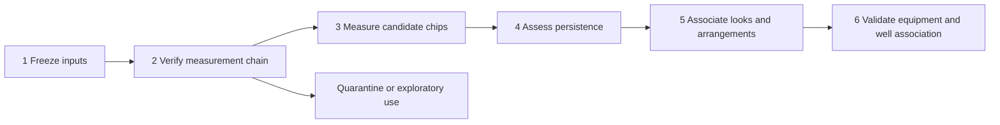

# NISAR reflector framework

Date: 2026-10-19. Status: **design and Python interface scaffold only; not run**.

## Purpose and scope

Develop the existing steady-bright-target work into a reproducible compact-reflector
investigation. Detectability, material identification, and association with wells are
separate endpoints. A bright return is not a steel label. Multiple looks can support
an object hypothesis without revealing its physical outline or resolving its parts.

The framework lives in `notebooks/wellsight_v2/nisar_reflectors/`. It has no CLI,
automatic data loading, or import of `_nisar_area.py` (which consumes arguments and
environment variables). The six modules declare backend contracts using Python
Protocols; they do not implement SAR processing. `nisar_contracts.py` defines shared
records. Protocol methods are specifications, not callable processing backends.
Existing scripts and results remain the baseline. No numerical thresholds below
are claimed validated, and no new performance results have been produced.

## Processing flow

Stages return evidence tables, including rejected cases and reasons. An unknown
quality check is not a pass. Gate decisions must be tied to the intended claim:
uncalibrated data can support explicitly relative exploratory work, but not RCS.
Failed absolute positioning must not silently become precise equipment matching.

## 1. Freeze inputs — `nisar_provenance.py`

**Inputs:** explicit area, stack state (`gslc`, `lidar_placed`, `date_coreg`, or
`absolute_coreg`), acquisition IDs, full product versions, paths, source indices,
RSLC/GSLC lineage, orbit and calibration metadata, DEM/geoid/offset artifacts,
source code snapshot and configuration. Preserve beta/provisional distinctions.

**Operations to implement:** resolve paths through the project path configuration;
read metadata without importing the old analysis modules; hash exact input bytes;
record selections and exclusions with reasons; capture CRS, datum, coordinate
epoch, transform, shape, band meaning, validity convention, and radiometry.
Dates alone are not product IDs. A Git commit alone does not identify dirty code:
hash the source files used as well. Do not infer calibration from a filename.

**Outputs:** immutable manifest, inclusion/exclusion ledger, content-derived run
ID. Use a new `data/<area>/results/nisar/reflectors/<run_id>/` directory on execution;
refuse overwrite. Distinguish a selected artifact's lineage from rejected artifacts
kept solely in the selection ledger. Raw downloads remain read-only.

**Gate:** every selected file/version and processing dependency is traceable;
same-track comparisons share frequency, polarization, geometry, and compatible
processing. A stack comparison must explicitly use common acquisitions or report
membership as a separate experimental factor.

**Integration:** `_nisar_area.py`, GSLC/RSLC fetch indices, and re-geocoder output
index. Its copied `valid_fraction` is provenance, not proof of current valid support.

## 2. Verify measurements — `nisar_quality.py`

**Inputs:** frozen manifest, independent reference targets with source/date,
phase-centre interpretation, height and positional uncertainty, and explicit
per-check acceptance limits. No automatic universal metre or dB tolerance.

**Checks:**

- Raster CRS, full affine transform, dimensions, band semantics, nodata and source
  interpolation support; preserve a per-pixel lidar/fallback-DEM flag.
- DEM vertical datum and geoid; consistent epoch-aware transformations in both
  simulation and production; orbit/time coverage and zero-Doppler convergence.
- Relative date registration: edge quality weights, outliers, network connectivity,
  cycle residuals and spatially varying residuals. Report internal residuals apart
  from absolute error against independent targets.
- Geocoding and re-sampling: source/destination point peak, integrated power,
  impulse-response width, sidelobes and localization; fractional-pixel and edge
  cases. High whole-image correlation alone does not satisfy this check.
- Calibration: inspect available LUTs/noise/validity masks, establish units and
  beta/provisional comparability. Do not silently substitute ones for absent LUTs.
- Terrain: local incidence, layover, and actual terrain obstruction; a back-facing
  facet mask is not a complete radar shadow calculation. Retain uncertain cases.
- Absolute placement: independent known targets and withheld spatial blocks.
  Terrain-brightness matching is supporting evidence, not a surveyed point check.

**Outputs:** per-check pass/fail/unknown evidence, spatial residual table, diagnostic
chips and capability decisions (`relative_contrast`, `cross_date_amplitude`,
`absolute_location`, `calibrated_rcs`, `phase_analysis`). A capability is granted
only after all its required checks pass; unknown blocks that claim.

**Integration:** `_nisar_geometry.py`, `_nisar_regeocode_lidar_9t.py`, and
`_nisar_lidar_sim_match_9t.py`. Do not use well hit-rate maxima to tune geolocation
and then reuse those wells as independent validation.

## 3. Measure candidate chips — `nisar_measurements.py`

**Inputs:** candidate seeds per track; manifest-bound native complex HH/HV chips;
source validity mask; geometry; target aperture, guard and background definitions;
quality report. Existing SBT points can seed a first comparison, but discovery
must eventually use a broader independent proposal rule to avoid conditioning
every result on the old amplitude-dispersion cutoff.

**Operations to implement:** locate the same target hypothesis consistently across
dates; preserve native range/azimuth coordinates and mapped position. Measure HH
and HV peak and integrated aperture power, background estimates at several scales,
contrast, background-subtracted energy, impulse-response widths, PSLR/ISLR,
and positional covariance. Estimate noise separately where metadata permits.
Return missing/uncertain values when background subtraction is nonpositive or
HV is noise limited. Do not turn missing values into zeros.

Joint HH/HV use requires documented calibration and alignment. HH/HV power contrast
is descriptive; it is not a unique double-bounce or metal classification. Preserve
complex samples for later phase modelling. Do not average raw phases from dates
or tracks. Oversampling supports peak fitting, not improved physical resolution.
RCS requires the applicable calibration and aperture/impulse-response convention;
plain pixel sums are relative energy, not square metres of RCS. Distributed-terrain
RTC factors must not be applied blindly to integrated point responses.

**Outputs:** one measurement per target/acquisition/polarization, footprint and
source-chip references. Metrics on one row must refer to the same target, not a
maximum brightness at one pixel paired with minimum dispersion at another.

**Integration:** retain `_nisar_steel_9t.py`'s 6 dB / 0.25 detector as a named
baseline. New background/guard apertures must be derived from the measured PSF
and local scene, not assumed from the 5 m map sampling.

## 4. Persistence — `nisar_persistence.py`

**Inputs:** measurement series grouped by object hypothesis, track, polarization,
and compatible processing cohort; acquisition schedule including missing dates.

**Operations to implement:** amplitude dispersion with an explicit standard
deviation convention; observation count, usable fraction, temporal extent,
median contrast, exceedance fraction, robust variability, position stability,
leave-one-date-out ranges, and sensitivity to beta/provisional membership.
Record acquisition IDs for every statistic. Missing dates are not nondetections;
finite-sample instability must be visible. Short records do not justify a universal
false-alarm interpretation of D_A < 0.25.

Where phase quality permits, fit a specified reference/atmospheric/topographic
phase model before estimating residual phase concentration. Report model and
reference identity. Bootstrap uncertainty only after choosing blocks consistent
with temporal dependence; leave-one-out ranges are sensitivity, not confidence
intervals. Use blocked discovery/evaluation dates where possible, and label any
full-record seed-selection optimism.

**Outputs:** continuous feature record, sensitivity ranges and explicit limitations.
No synthetic single 'probability of steel' until calibrated against independent
equipment truth. A candidate may remain useful on only one viewing track.

## 5. Looks and arrangements — `nisar_association.py`

**Inputs:** per-track hypotheses, position covariance, geocoding errors, LOS geometry,
plausible scattering-height interval, measured footprints, and common CRS/epoch.

**Operations to implement:** propose cross-track edges using propagated position
uncertainty and height-dependent ground projection; score compatible features;
retain ambiguity and unmatched detections. Constrain groups to one hypothesis per
track, require pairwise compatibility (no transitive A-B-C distance chaining), and
retain every member and rejected alternative. Correlated geolocation errors must
not be treated as independent just because tracks differ. Do not require equal
brightness or detection on every viewing direction.

After per-object association, separately describe arrangements: pair distances,
orientation, compactness, spacing consistency, track-dependent response, and
context distances. A line of radar peaks could be a sidelobe pattern or terrain
edge; check PSF and native chips before assigning a physical arrangement. Keep
within-track sidelobe suppression separate from cross-track matching. Geometry
below the effective resolution is a hypothesis, not a recovered object outline.

**Outputs:** edge table with residuals and reasons, member table, unresolved
alternatives, group extents and arrangement descriptors. Stable IDs derive from
manifest and member identity rather than brightness sort order.

**Integration:** replaces the *design* of `merge_tracks`, but does not modify the
old implementation yet. The existing 15 m connected components are a baseline.

## 6. Validation — `nisar_validation.py`

Two studies, with separate conclusions:

1. **Equipment detection:** independently verified equipment presence/absence,
   material if known, observation date, height and uncertainty; blinded reviews
   of detections and sampled nondetections. Reserve spatial blocks before tuning.
   Evaluate precision/recall, localization and review burden by canopy, terrain,
   track and equipment class. DEP administrative status is context, not this truth.
2. **Well association:** prespecified matching radius justified by positional
   uncertainty; controls matched on canopy, slope/aspect, road/structure proximity,
   coverage and geography. Retain match-set IDs and all sampled/rejected controls.
   Preserve sets in permutation or conditional analyses and bootstrap spatial
   blocks rather than treating nearby pixels as independent replicates. If a
   set cannot supply controls, report exclusion instead of silently changing
   weighting. For annular spatial sampling use uniform area, not uniform radius.

Use the same per-track opportunity/validity footprint for cases and controls;
never compare a union-of-tracks detection population to an intersection-only
background without modelling that difference. Join masks by stable IDs, not row
order after sorting. Prespecify primary metrics; label exploratory families and
handle multiple comparisons. Publish effect sizes and uncertainty, not only p.

**Outputs:** equipment metrics, separate matched association estimates, full match
ledger, spatial split table, exclusions and machine-readable limitations. Unknown
equipment labels are excluded from supervised metrics and counted separately.

## Contracts, artifacts and implementation order

Shared tables use stable IDs. Optional values mean unknown, not zero or pass.
Numeric `Metric` records carry units and methods. Quality checks carry evidence
artifact IDs. Each future backend must validate contracts before processing;
annotations alone do not enforce schema or numeric validity at runtime.

Planned run artifacts: `nisar_manifest_<area>.json`, `nisar_quality_<area>.json`,
`nisar_measurements_<area>.parquet`, `nisar_persistence_<area>.parquet`,
`nisar_association_edges_<area>.parquet`, `nisar_association_members_<area>.parquet`,
`nisar_arrangements_<area>.parquet`, `nisar_validation_<area>.json`,
`nisar_validation_matches_<area>.parquet`. These are contracts, not files generated
in this change. Large chips stay in a separately ignored derived directory; add
that targeted ignore rule in the same change that first generates them.

Implement manifest/metadata adapters first, then quality checks on a bounded pilot
of 3–5 independently identified targets plus clutter. Next implement chip measures
and persistence, then association and validation. Before broader processing,
verify fractional-pixel localization, known gain changes, nodata edges, zero/negative
background-subtracted power, missing dates, same-track merge rejection, A-B-C
chaining, ambiguous candidates, and matched-set spatial leakage. Synthetic tests
must complement independent observed targets. No tests or pilot were run here.

## Coverage of the full audit

| Audit concern | Stage |
|---|---|
| Object + clutter model; existing threshold interpretation | 3, 4 |
| DEM offsets, scattering height, absolute placement | 2, 5 |
| Registration weights, epoch and network quality | 2 |
| Resampling, point response and radiometry | 2, 3 |
| Short-series uncertainty | 4 |
| Terrain/clutter background and CFAR interpretation | 2, 3, 6 |
| Connected components, sidelobes and track matching | 3, 5 |
| HV, phase and viewing geometry | 3, 4, 5 |
| Equipment truth versus DEP status | 6 |
| Controls, spatial dependence and mask alignment | 6 |
| Explicit stack state, product version and validity | 1, 2 |
| Reflective arrangements and sub-resolution limits | 5 |

## References and reproduction status

Local evidence: `nisar_regeocode_plan_9t.md`, `_nisar_steel_9t.py`,
`_nisar_bright_targets_9t.py`, `_nisar_geometry.py` and
`_nisar_regeocode_lidar_9t.py`. Read with the original static audit; existing
results do not validate these proposed replacement methods.

Scientific references used in the preceding review:
[ASF RSLC](https://nisar-docs.asf.alaska.edu/rslc/),
[ASF GSLC](https://nisar-docs.asf.alaska.edu/gslc/),
[ASF known issues](https://nisar-docs.asf.alaska.edu/product-known-issues/),
[PROJ time-dependent transforms](https://proj.org/en/stable/operations/time_dependent_transformations.html),
[Ferretti et al. 2001](https://sismologia.ist.utl.pt/~sismologia.daemon/files/Ferretti_2001.pdf),
[Hooper et al. 2004](https://doi.org/10.1029/2004GL021737),
[Czikhardt et al.](https://doi.org/10.1109/LGRS.2021.3070045).

Reproduce command: none yet. This scaffold intentionally has no runner; concrete
backends, runtime validation and pilot checks must exist before data processing.
