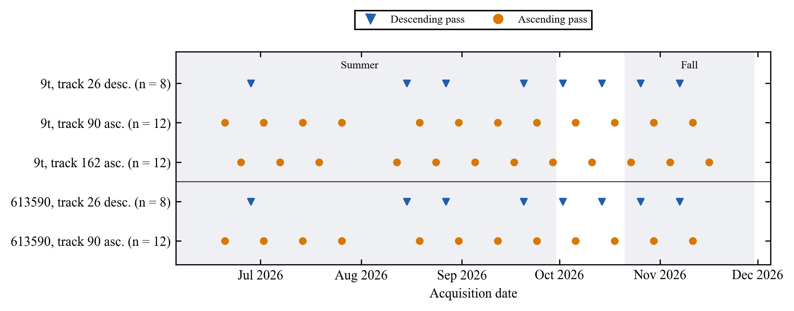
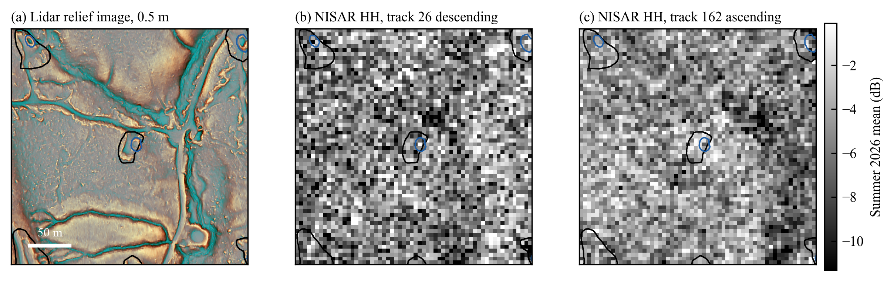
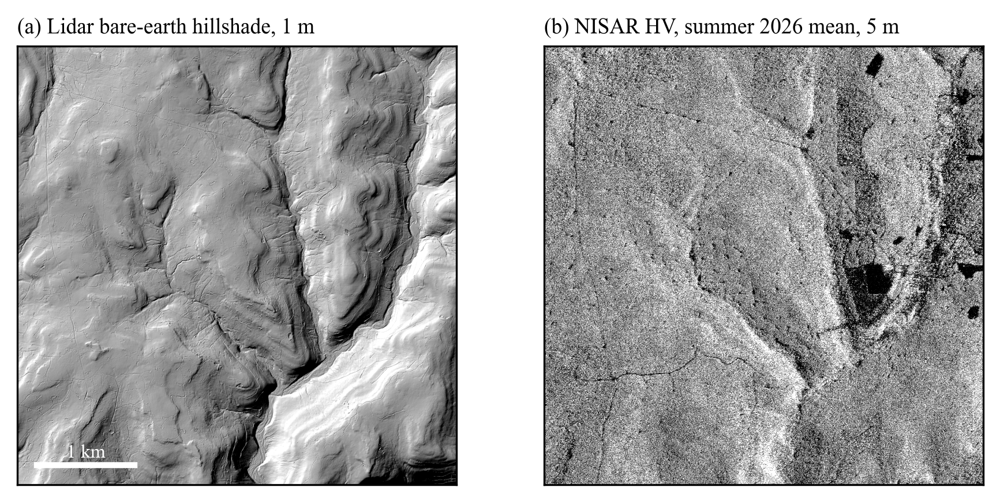

# NISAR L-band radar at known oil and gas well sites, tile 9t, western Pennsylvania

CIVE 6359 capstone design write-up. Draft of 2026-11-23. Section 7 is filled in after the oral on December 1.

## 1. Question and site

**Question.** At known well sites on tile 9t, does NISAR L-band radar show a repeatable contrast at well pads, pits or surface steel that differs from nearby ground with no well?

**Site.** Tile 9t is a 4.5 km square in Venango County, Pennsylvania, centred near 41.50° N, 79.54° W. It is steep, forested Appalachian Plateau ground with 150 years of oil drilling. Lidar mapping gives 506 pits and 645 pads. Pennsylvania DEP lists 1,068 wells inside the tile. A well pad is the cleared, graded ground around a well. A pit is the dug hollow beside it.

**Expected signal.**

- Pits and pads: a backscatter contrast against their surroundings of about 0.1 to 0.5 dB. One site cannot show this, because a single pixel's brightness spreads by 2.2 to 2.4 dB. Hundreds of sites must be pooled.
- Steel (casing, tanks): pixels at least 6.5 to 7.2 dB above the ground within 250 m, with amplitude dispersion under 0.25.
- Pad disturbance: a coherence drop between two dates larger than 99% of control spots show.
- Pit or slope motion: more than about 12 mm in 12 days, the noise floor of one interferogram pair at a pit.

**Why radar can see it.** A pit or pad changes slope, roughness and canopy gaps at the scale of a 5 m pixel. Steel gives a strong, steady echo. Work on a pad scrambles the surface between passes, which breaks coherence. Lidar already maps these features but is flown once. Radar repeats every 12 days at no cost.

## 2. Data

**Mission and band.** NISAR, L-band (24 cm wavelength, 1.239 GHz). *Why L-band.* The targets sit under deciduous canopy. A 24 cm wave passes through leaves to the ground better than C-band (5.5 cm) or X-band (3 cm), and it keeps coherence longer under forest.

**Product.** Level 2 geocoded single-look complex images (GSLC), HH and HV, 5 m grid. Level 1 single-look complex images in radar geometry (RSLC) for re-placement on the lidar. Both keep phase, so one product gives backscatter, coherence and interferograms.

**Geometry at 9t.**

| Track | Pass | Look direction | Incidence angle | Dates used |
|---|---|---|---|---|
| 26 | Descending | East | 41° | 8 |
| 90 | Ascending | West | 39° | 12 |
| 162 | Ascending | West | 47° | 12 |

These are every NISAR track over 9t. Ascending and descending passes see each slope from opposite sides, so a feature hidden from one side can show from the other.

**Dates.** First 2026-06-20, last 2026-11-16, 12-day revisit, 32 acquisitions across three tracks. Summer is June to September. Fall is 21 October to 30 November, after leaf drop. Earlier beta dates (October 2025 to January 2026) are excluded, because their calibration differs and every fall date was beta. Two dates on track 26 are dropped, one with no valid pixels and one placed far from the rest of its track.

*Figure 1. Dates used per track on tile 9t. Shading marks the summer and fall windows, fixed before any test was run.*

**Sources.** NASA ASF DAAC through ASF Vertex, collections `NISAR_L2_GSLC_PROVISIONAL_V1`, `NISAR_L2_GSLC_V1`, `NISAR_L1_RSLC_PROVISIONAL_V1` and `NISAR_L1_RSLC_V1` [1]. Data are read as windows over 9t with HTTPS range requests, tens of megabytes per date instead of 22.6 GB.

**Data checked against.** USGS 3DEP lidar `PA_WesternPA_2019_D20`, quality level 2 [2]. Pennsylvania DEP oil and gas well locations, April 2026 export [3]. Pit and pad outlines drawn from that lidar.

## 3. Processing steps

| Step | Tool | Key choice |
|---|---|---|
| 1. Find and fetch windows over 9t | NASA CMR search, h5py and fsspec range reads | Search every NISAR collection. New dates moved to a standard collection on 2026-10-23 |
| 2. Place each image on the lidar ground | Own geocoder in Python, from RSLC | Echo height at the lidar ground plus 10% of canopy height. NASA's model placed pixels 8 to 12 m off |
| 3. Co-register dates and tie each track to the lidar | Lidar backscatter simulation, block cross-correlation | Gate of 2.5 m per block |
| 4. Seasonal backscatter per track | numpy | Average power in linear units before converting to dB |
| 5. Feature against ring against control spots | Python, rasterio, geopandas | Ring 10 to 30 m for pits, 20 to 60 m for pads. Five control spots 150 to 600 m away |
| 6. Persistent-scatterer selection | numpy, scipy | Amplitude dispersion under 0.25 [4], brightness 3 robust SD above the 250 m median, hit radius 6 m |
| 7. Coherence change at pads | Interferograms of back-to-back dates, 5 × 5 window | Event threshold at the 1% tail of control spots |
| 8. Motion at pits and slopes | Interferograms, 25 m multilook, summed pair phases [5] | 1 km low-pass removed as atmosphere, coherence mask 0.45 |
| 9. Statistics | scipy | Wilcoxon signed-rank on the per-site excess, bootstrap 95% interval |

Every step runs per track. Tracks are combined only after each site's contrast is measured, because each track has its own geometry and calibration.

*Figure 2. Pad 303, 300 m across. Lidar relief image, then NISAR summer HH from the descending and an ascending track. Pads outlined black, pits blue. The pad cannot be seen by eye in speckle, which is why sites are pooled.*

## 4. How I would check the result

**Independent evidence.**

- Placement: the lidar simulation check, and surveyed points or corner reflectors if they can be set out.
- A known answer: a building at 41.502787, -79.519712 should pass the steel screen.
- A second track: a real feature should show on more than one track. Real motion should agree between tracks 90 and 162.
- A second sensor: Sentinel-1 C-band at the same pits, as a possible extension.

**Results that would show something went wrong.**

- Control spots differ from each other as much as features differ from control spots.
- A contrast appears on one track only, or flips sign between tracks with similar geometry.
- A contrast grows when the placement is shifted by 5 to 10 m, which would mean the ring and not the feature carries it.
- The building fails the steel screen.

## 5. What could go wrong

| Risk at 9t | How I would notice | What I would do instead |
|---|---|---|
| Too few acquisitions. Persistent-scatterer selection was designed for about 30 dates [4]. 9t has 8 to 12 per track | Steady pixels flood open fields, or the pass rate exceeds the 3 SD expectation | Raise the brightness cutoff, require two tracks, add dates as NASA releases them |
| Decorrelation under deciduous canopy and wet snow | Coherence below 0.45 over most of a track. Track 162 is coherent over 39% of the tile | Use only short pairs, mask by coherence, lean on backscatter tests |
| Signal smaller than noise | Interval of the excess spans zero, or results move with the control-spot draw | Pool more sites, run 40 control spots per site with a swap test, match control spots on canopy and slope |
| Layover and shadow on steep valley sides | Bright or black bands that follow slope aspect and differ between ascending and descending | Mask by lidar-simulated layover and shadow, compare tracks |

## 6. Plan

| Dates | Step |
|---|---|
| 7 to 13 December 2026 | Fetch new December passes. Rebuild the lidar-placed stack |
| 14 to 20 December | Match control spots on canopy, slope and road distance |
| 21 to 27 December | Map hollows with no well from the 9t lidar |
| 28 December to 3 January 2027 | Run 40 control spots per site with a swap test |
| 4 to 10 January | Rerun brightness, coherence and steel tests on all dates to date |
| 11 to 17 January | Compare pits with hollows that have no well |
| 18 to 24 January | Possible Sentinel-1 cross-check at the same pits |
| 25 to 31 January | Write up. Persistent-scatterer step 2 waits for about 20 dates per track, expected in spring 2027 |

**Needs.** Data: about 80 MB per date for HH and HV windows, plus RSLC windows, a few GB in all. Computing: one laptop. Software: Python with h5py, fsspec, numpy, scipy, rasterio and geopandas. No commercial software.

## Bonus: a real product from the site

*Figure 3. Tile 9t. Left, lidar bare-earth hillshade, 1 m. Right, NISAR HV mean backscatter, track 162, the eight summer 2026 dates from 2026-06-25 to 2026-09-29, re-placed on the lidar ground and averaged in linear power. It shows L-band reaching the ground under canopy: valleys and slopes match the lidar. Limits: terrain lighting dominates, speckle hides features smaller than tens of metres, and calibration is provisional.*

## 7. Changes after the oral

[To be written after December 1.]

**AI disclosure.** Claude (Anthropic) wrote and ran much of the processing code, produced the figures, and drafted the text of the slides and this write-up from my direction; I set the question, site, band and constraints, reviewed every step, and the design decisions are mine.

## References

1. NASA ASF DAAC. NISAR Level 1 RSLC and Level 2 GSLC products. ASF Vertex, https://search.asf.alaska.edu/
2. U.S. Geological Survey. 3DEP lidar, project PA_WesternPA_2019_D20. https://www.usgs.gov/3d-elevation-program. Base specification: https://doi.org/10.3133/tm11B4
3. Pennsylvania Department of Environmental Protection. Oil and gas locations, conventional and unconventional, April 2026 export. https://www.dep.pa.gov/DataandTools/Pages/GIS.aspx
4. Ferretti, A., Prati, C., Rocca, F. (2001). Permanent scatterers in SAR interferometry. IEEE Transactions on Geoscience and Remote Sensing 39(1), 8–20. https://doi.org/10.1109/36.898661
5. Berardino, P., Fornaro, G., Lanari, R., Sansosti, E. (2002). A new algorithm for surface deformation monitoring based on small baseline differential SAR interferograms. IEEE Transactions on Geoscience and Remote Sensing 40(11), 2375–2383. https://doi.org/10.1109/TGRS.2002.803792
