# NISAR radar for orphaned wells: what we did and what it showed

Written 2026-11-02. Study tile 9t, Venango County, Pennsylvania.

This is the plain-language story of every NISAR test in the project. It says what each test was, why we ran it, how it came out, and what that means. Every number comes from the project record. The sources are listed at the end.

## The short version

- We asked whether NISAR, a NASA and ISRO radar satellite, can find or describe well pads, pits, wells and pumpjacks.
- We built the whole chain. That included finding and fixing a 10 m placement error in NASA's own product.
- On its own, the radar shows a weak pattern at pads. Most of it turned out to be location, not the pad.
- Adding the radar to lidar never reached the +0.05 gain we set as the bar before we looked.
- A radar pixel is 5 m. A pit interior is about 8 m by 5 m. The small box you see beside many pits is about 1.5 m. The radar cannot resolve the box and cannot isolate the water.
- Lidar can do these jobs. Lidar laser strength separated 13 pits you labelled wet or dry. NISAR did not.
- The claim is narrow. Our tests did not show a gain. They do not prove the radar can never help.

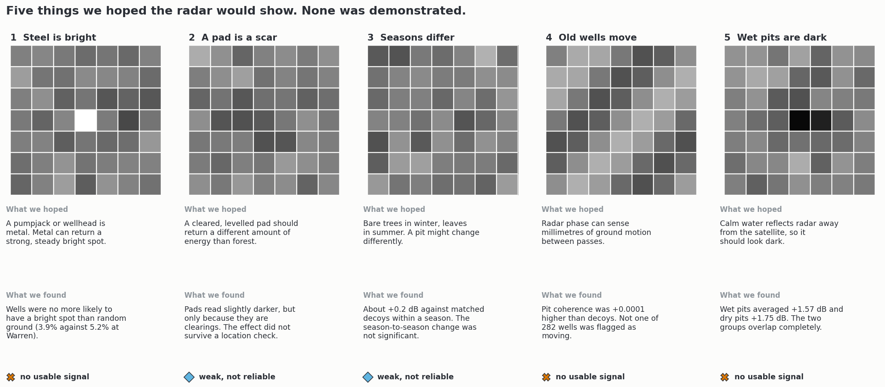

## 1. What NISAR is and what a pixel means

**The satellite.** NISAR sends out radar pulses and records the echo. It uses L-band, which has a wavelength of about 24 cm. That is long enough to pass through many leaves. It looks sideways to the left. Each of its three tracks over our tile repeats every 12 days. Tracks 90 and 162 fly north (ascending) and look west. Track 26 flies south (descending) and looks east.

**What the number means.** The strength of the echo is called backscatter. We report it in decibels (dB). Every 3 dB is a doubling. The radar sends and receives in two polarisations. HH sends and receives horizontally. HV sends horizontally and receives vertically. HV responds mostly to rough, volume-like targets such as tree crowns.

**The product.** We used the Level-2 GSLC product. Each pixel holds a complex number, so it carries both amplitude (strength) and phase (a fine distance measure). The pixels sit on a 5 m grid.

**A pixel is not a clean 5 m measurement.** We measured the real sharpness of the images. The smallest thing they can separate is about 3.9 m in slant range (about 5.3 to 6.2 m on the ground at 39 to 47 degrees incidence) by 5.7 m along track. Both come from bright uncontrolled scatterers, so treat them as rough. Neighbouring pixels are correlated at 0.38. So a 5 m pixel is a blurred average over a patch a little bigger than itself.

**Speckle.** Radar echoes from many small scatterers add up with random phase. The result is a grainy image. A single pixel of ordinary ground varies from date to date, even though the ground has not changed. Any real signal must be bigger than that, or it must be averaged over many dates.

### How big is a pit to this radar?

Across our annotation file the pit exteriors (`pit_full`) average about 18 m by 14 m, or 211 m². The pit interiors (`pit_inside`) average about 8 m by 5 m, or 32 m². One standard deviation either side gives exteriors of 15 to 22 m by 12 to 17 m and interiors of 6 to 10 m by 4 to 7 m.

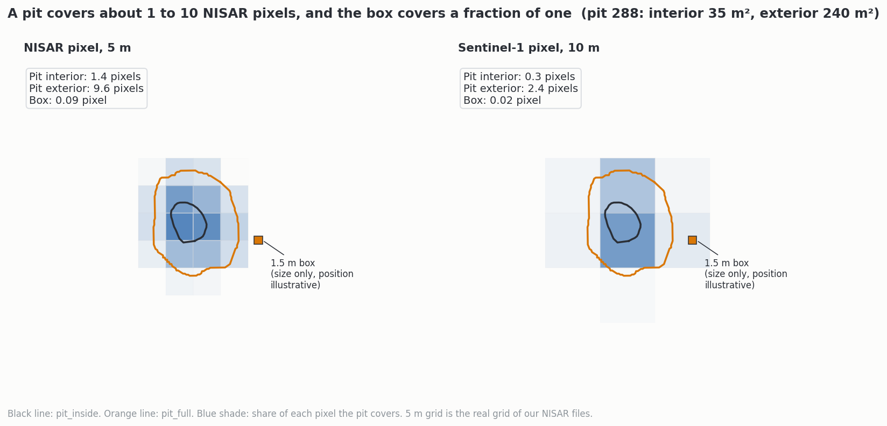

At 5 m, the interior of a typical pit covers about one pixel and the whole exterior about ten. A 1.5 m box covers about 9% of one pixel. Sentinel-1, a C-band satellite with 10 m pixels, sees the interior as a third of a pixel.

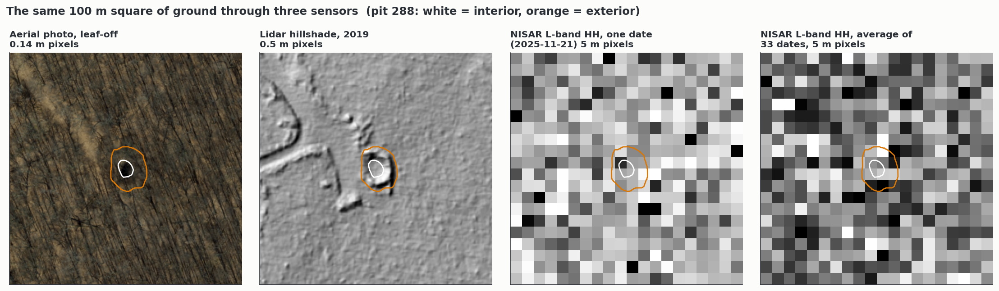

This figure is the most direct picture of the problem. The leaf-off aerial photo shows a dark pool. The lidar hillshade shows a bowl with a rim. In the radar the pit is a few grey squares among many similar ones, even after averaging 34 dates.

## 2. The data we had

We used NISAR GSLC scenes over tile 9t. The first was taken on 2025-10-28 and the last on 2026-10-14. That is 37 dates across three tracks. 35 are usable after dropping one empty and one misplaced granule. The lidar-placed stack used for the corrected classifiers has 33 (8, 11 and 14 on tracks 26, 90 and 162), because two October dates came later.

- **Beta products.** 11 dates from October 2025 to January 2026. Beta means the calibration was not finished.
- **Provisional products.** 26 dates from June to October 2026. ASF describes these as fully calibrated and partly validated.
- **Dropped.** Two track-26 granules (2026-07-22 and 2026-09-08) are misplaced or empty. The analysis stack and the corrected classifiers drop both. An outside review (2026-11-09) found three readers that still kept 2026-09-08: the wet/dry pit table, the averaged image in the three-sensor figure, and the signal-quality table. All three now drop it. The wet/dry conclusion does not change.

Each GSLC file is about 22.6 GB. We did not download whole files. We read only the part that covers our tile, using HTTP range requests. Each saved window is about 9 MB.

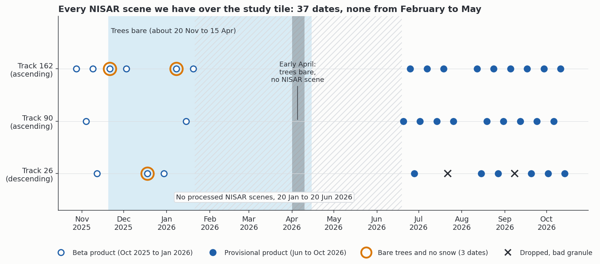

### The gap from February to May

No processed scene exists between 2026-01-20 and 2026-06-20. The cause is release timing, not missed collection. NISAR has been acquiring on its plan since September 2025. NASA and the Alaska Satellite Facility are releasing the earlier months gradually through the second half of 2026. They plan validated reprocessing in the fourth quarter of 2026.

Raw files (called L0B) do exist for the gap. They are 45 to 83 GB each. Our Earthdata account got a 403 error (access denied) on them. We could not test whether the denial is permanent.

### Leaf-off and snow

Bare trees should let L-band reach the ground more easily. We worked out when the trees were bare from NOAA daily weather records and from Sentinel-2 vegetation greenness. Trees are bare from about late November to mid April. Leaves come out from late April to late May.

Only three NISAR dates are bare and snow-free. They are 2025-11-21 (track 162), 2025-12-18 (track 26) and 2026-01-08 (track 162). Track 90 has none. Early April, the time you asked about, falls in the gap. Sentinel-2 had no clear view of the ground from late October to early February, so the November and December leaf state is interpolated.

L-band barely separates open ground from closed canopy at 5 m in our own control (AUC 0.50 to 0.56). So the leaf-off dates are less valuable than they sound.

## 3. Fixing the placement

**The problem.** A radar image is only useful at a target if it is placed on the right ground. We simulated what the radar should see from our 1 m lidar terrain model and slid it over NASA's image to find the best match. The typical shift was 9.6 m, 11.9 m and 9.1 m on the three tracks, always away from the satellite. That is about two pixels. None of the 48 test blocks was within 2.5 m.

**The cause.** NASA flattens the image with a Copernicus elevation model. That model is a radar surface, so it sits a median 6 m above the lidar ground and about half the tree height under forest. A height error of a few metres becomes a ground shift of several metres in a side-looking radar.

**The fix.** It took five stages.
1. Fetch the raw single-look scenes (RSLC) for each date.
2. Write our own geocoder. It reproduced NASA's GSLC to within 0.02 of a pixel, with an amplitude correlation of 0.997 to 0.998. This showed we understood the processing before we changed anything.
3. Swap NASA's heights for lidar heights.
4. Trace the leftovers. The lidar and radar grids use different datums, 0.80 m west and 1.01 m north apart. Beta and provisional products sit 3.2 m apart in slant range because NASA changed a calibration file between them. Track 26 jumps along its flight path from date to date.
5. Solve one offset per date by least squares across all date pairs, then one constant per track.

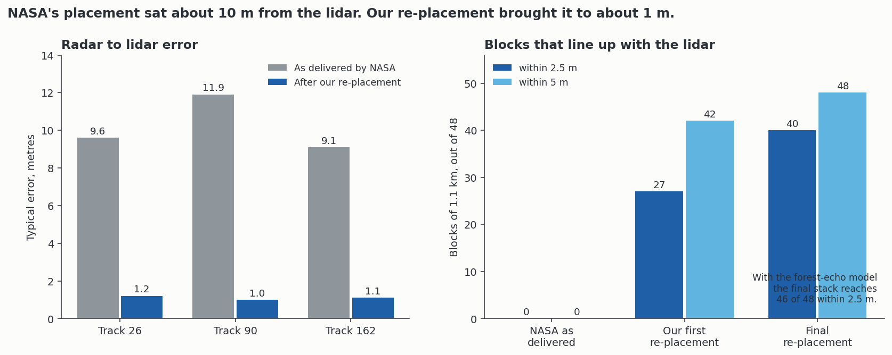

**The result.** The typical error fell from about 10 m to about 1 m. With a model of the forest echo, 46 of 48 blocks sit within 2.5 m on this tile. On the second tile (613590) it is 31 of 48, and the worst block is 29.7 m out. We fitted the constants on half the blocks and tested them on the other half. On 9t every held-out half passed. On 613590 they passed 6/8 and 3/8 on track 26, 5/8 and 5/8 on track 90, and 4/8 and 5/8 on track 162.

**A limit.** The lidar simulation both supplies the offsets and scores the match. So these counts measure agreement with that simulation. They are not an independent measure of position. The independent test, with steady bright points and wells, found no peak, so position is not independently confirmed on either tile.

## 4. The five ideas and how each one came out

### 4.1 Steel is bright

**The idea.** A wellhead or pumpjack is metal. A corner of metal can send a strong, steady echo back to the satellite.

**The test.** We looked for steady bright targets. These are pixels at least 6 dB above their 250 m surroundings that stay steady from date to date. We asked whether known wells were more likely than random ground to have one within 15 m.

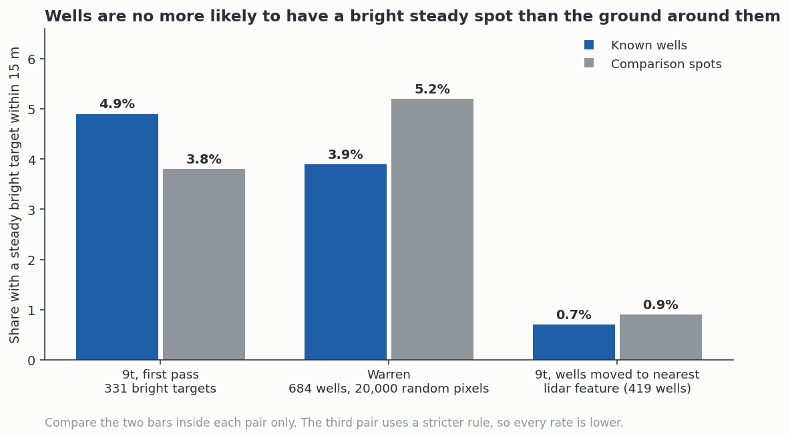

**What we found.** Wells were not more likely to have a bright steady target. At Warren it was 3.9% for wells and 5.2% for random pixels (p 0.16). Moving the wells onto the nearest lidar pit or pad changed nothing. DEP well coordinates can be wrong by tens of metres, so we tried that on purpose.

**A real result inside the null.** Bright steady targets do repeat from track to track. Pairs with track 162 coincide 6 to 8 times more than chance. So they are real, stable objects. We checked 75 of them on the lidar hillshade and Sentinel-2 images. They were buildings, towns, bridges, riverbanks and graded industrial pads. None was a lone well or pumpjack.

**The lidar version.** We also searched the lidar for bright, compact objects 2 to 7 m tall near wells. Wells scored 37% and matched controls 53%. Wells scored lower.

### 4.2 A pad is a scar

**The idea.** A cleared, levelled pad should return a different amount of energy than the forest around it.

**What we found.** In the first test, pads read about 0.3 dB darker than their forest ring. Open pads read 0.8 to 0.9 dB darker. That is the clearing, since a clearing has no canopy. After we fixed the placement, even that small darkening vanished. A pad is too weak a signal to detect alone.

### 4.3 Pits change with the season

**The idea.** Trees are bare in winter and leafy in summer. A pit might change by a different amount.

**What we found.** We compared each pit with 40 matched decoy spots and used a swap test that keeps whole time series together. Within the leaf-off fall season, pits were +0.25 dB brighter in HH than their decoys. Within the leaf-on season they were +0.19 dB brighter in HV (swap test p below 0.001 for both, tile 9t). These are pit-versus-decoy contrasts inside one season, not a seasonal change. The tests of change between seasons were not significant (HH -0.10 dB, p 0.13; HV +0.05 dB, p 0.47). Season is also tangled with processing level (all winter dates are beta, all summer dates provisional), track and snow. A small contrast can sit below one-date speckle and still be detectable over many dates, so speckle alone does not rule it out. The pattern did not hold in the same way in the other areas. We treat it as a lead and not as a detection.

### 4.4 Old wells move

**The idea.** Radar phase can sense a few millimetres of ground motion between two passes. Coherence says how stable the echo stays between passes. Low coherence means the surface changed.

**What we found.** Tile coherence is decent. The median is 0.50 in HH, and the best 12-day pair reaches 0.68. So we could measure motion at larger scales. At pits there was nothing. The pit coherence excess over decoys was +0.0001 (and -0.005 when shifted). The noise of one pair is about 7.5 mm for pits and decoys alike. We also looked for slope creep. No well among 282 was flagged as moving.

### 4.5 Wet pits are dark

**The idea.** Calm water bounces radar away from the satellite, so a wet pit should look dark.

**Test 1: NISAR.** We took the 13 pits you labelled by eye (eight wet, five dry, counting pit 512, which the raw lidar cross section showed was water). For each pit and each of the 36 usable scenes we measured the centre pixels against a 20 to 100 m ring.

**Test 2: Sentinel-1.** You asked for something in early April, when the trees are bare. NISAR has no scene then. So we used Sentinel-1, a C-band satellite with 10 m pixels. Its track 77 is the only one usable in that window. Track 4 returned no data. At pit 459 the centre read +0.72 dB above its ring with a spread of 1.59 dB across 18 dates. At pit 626 it read +0.40 dB with a spread of 2.21 dB across 17 dates. Neither is above the scatter. There was no steady bright return at either pit.

**Test 3: lidar.** Water absorbs the laser pulse. We measured the strength of lidar ground returns inside each pit and divided by the strength just outside. It was the only measure that separated your labels.

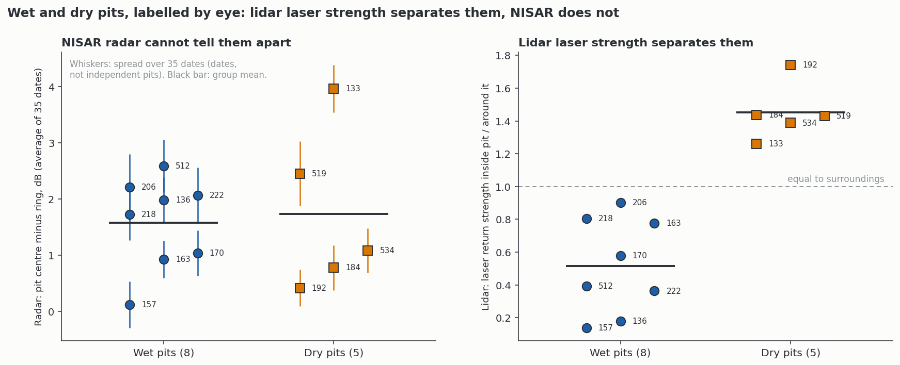

**What we found.** NISAR gave +1.58 dB for wet pits and +1.74 dB for dry, after dropping the flagged date (+1.57 and +1.75 before). The groups overlap completely. The lidar ratio was 0.14 to 0.90 for wet pits and 1.26 to 1.74 for dry. Those two ranges do not touch.

**Limits.** There are only 13 pits and no held-out set. The wet and dry labels come from one look at 2019-era imagery and lidar, and pit 512 was labelled from a lidar cross-section, so the lidar result is not independent of its labels. The radar dates are 2025 to 2026, so a pit wet in the reference may not be wet on every radar date. Removing pit 512 leaves the lidar ranges still apart. A cut at 1.0 is too loose. Across all 714 pit interiors it calls 258 of 502 measured pits wet. The grey zone from 0.8 to 1.2 needs your eyes in Google Earth. 211 pits fall outside the lidar tiles and could not be measured.

## 5. Why the early scores looked good

At the start the pad score looked impressive. Several early runs gave an AUC of 0.71 to 0.88. The rest of this section explains why those numbers were not what they seemed.

**What AUC means.** Take one real pad and one look-alike spot, chosen at random. AUC is the chance that the pad gets the higher score. 0.50 is a coin flip. 1.00 is perfect.

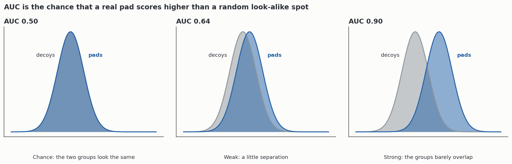

**What a decoy is.** A decoy is a spot with similar canopy cover and slope but no pad. If the pad can be told from its decoys, the radar might be seeing something about pads.

**The trap.** Where you draw the decoys matters a great deal. If decoys come from anywhere on the tile, a model can score well just by learning where pads tend to be. That is location, not the pad. We tested it three ways.
- We shuffled the labels within 500 m blocks. The score was still 0.775.
- We moved the pads 150 to 300 m to make fake pads (a placebo). A model fed only map coordinates scored 0.890 on the fake pads. The radar scored 0.504, which is chance. So the placebo was honest for the radar and caught the coordinates.
- We built a model using map x and y alone. On the local design it scored 0.738, higher than the radar's 0.713.

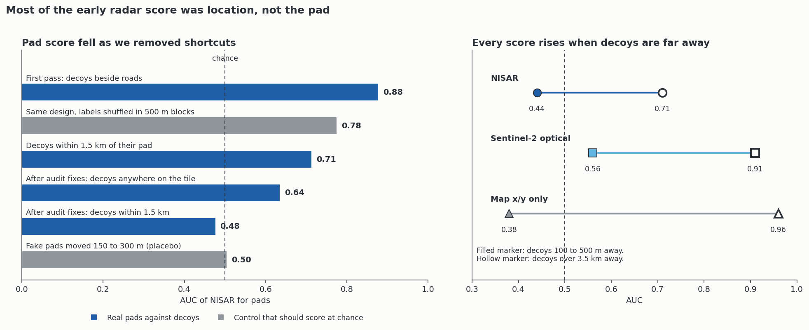

**The audit.** Two outside reviews and a code audit then found real defects. Examples include pads assigned to the wrong block (13.9%), 76% of pads scored on fewer pixels than their decoys, a known bad date still in the data, and a height formula off by a factor of 10,000. We fixed them and re-scored.

**After the fixes.** (A later check dropped repeated decoy locations. Dropping repeated decoy locations moves the radar-alone scores (pits 0.83 to 0.77, pads with local decoys 0.48 to 0.60). It does not move the gain over lidar (pits -0.004, pads -0.008). Radar-alone scores depend on the decoy set and should not be quoted as headlines. See `docs/iterations/outside_review_response_20261103.md`, section 8.) Pad AUC fell to 0.635 with decoys anywhere and 0.476 with decoys within 1.5 km. For pits, the radar scored 0.832, but map x and y alone scored 0.955 and rich lidar 0.968. The radar score also rose steadily as decoys were moved farther from the pad. It went from 0.44 at 100 to 500 m to 0.71 beyond 3.5 km. Map x and y rose from 0.38 to 0.96 over the same range. That pattern means the radar is telling places apart.

## 6. Does the radar add anything to lidar?

**The bar.** Before the main runs we set a rule. NISAR plus a rich lidar model had to beat the lidar model alone by 0.05 in AUC. A limit of this rule: the rich lidar model already scores 0.917 on pads and 0.968 on pits on 9t, so on pits a gain of 0.05 was arithmetically impossible there (it would need 1.018). On 9t pits, "no gain" cannot be told apart from "no room". The test that can is the held-out one on 613590 (lidar 0.881, gain -0.017, block bootstrap 95% interval -0.055 to +0.020, reproduced from saved predictions), which excludes +0.05 for pits on that tile. For pads there is no held-out test.

**The tests.** We tried every place where lidar might be weak. These were pads the lidar U-Net missed, pads under canopy, the weakest quarter of pads, a second tile with frozen models, and a comparison with free Sentinel-2 imagery.

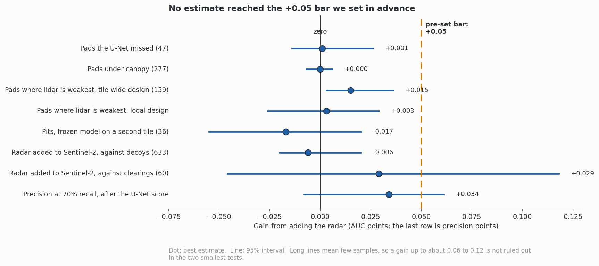

**What we found.** No estimate reached 0.05. The best, in the lidar-weak quarter, was +0.015, and it came from the design that rewards location. Free Sentinel-2 did as well as the radar or better (0.840 against 0.622 on matched decoys). Fusing the radar with the U-Net gave 0.995 against 0.999 for the U-Net alone. That test is capped by the U-Net's near-perfect score. On the second tile the three predictions we wrote down before the run all held. Two caveats. Pits on that tile had been scored by earlier tests before the pre-registration, so it was pre-registered for this classifier only. And the saved row-level predictions come from a rerun on 2026-11-03 that reproduces the original numbers exactly; the original rows were not kept.

**What is not excluded.** Two tests have few samples (60 pads and 36 pits), so their intervals are wide. A gain of 0.06 to 0.12 cannot be ruled out there. The honest reading is that we found no reliable gain and did not prove there is none.

## 7. What the radar actually follows

We compared 50 m block averages of the radar with lidar and optical layers. R² is the share of the radar's variation that a set of layers explains.

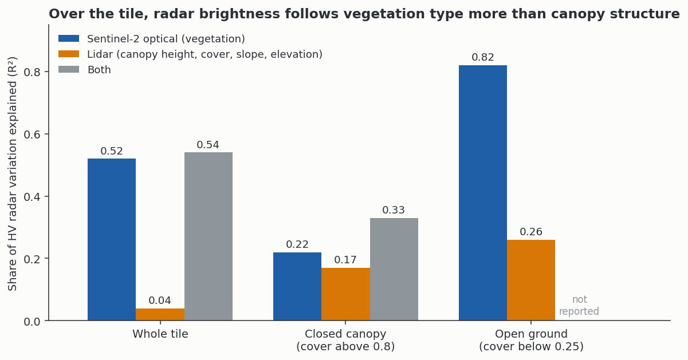

- Across the tile, vegetation greenness explains 52% of HV. Lidar canopy height, cover, slope and elevation explain 4%.
- Inside closed forest the picture is different. Optical explains 22% and lidar 17%. Together they explain 33%.
- In closed forest the lidar share is mostly terrain lighting, not tree height. Adding a simulation of the terrain gain lifted lidar R² from 0.07 to 0.57.

**Caution.** This is correlation. It does not split the echo into ground and canopy parts. L-band HV also saturates at moderate biomass. Mature hardwoods may be past that point, so height would explain little whatever the physics.

## 8. What the radar can and cannot say about the box

The box you spotted is about 1.5 m across. The radar sees 5 m pixels with a real sharpness of 3.9 by 5.7 m. A single metal box could light a pixel if it formed a corner reflector. We never saw that. The steady bright targets we did find were buildings and bridges.

For the box, lidar and aerial photos are the right tools. The lidar at your first point shows a flat-topped block 1.1 to 1.4 m tall. It spans about 3 by 4 cells on the 1 m grid, which is larger than your 1.5 m estimate. We have not reconciled the two. The leaf-off aerial photos from the state (0.5 ft pixels) show pit shapes clearly. Their outlines line up with our lidar-based pit outlines. That points to Google Earth's own imagery as the source of the offset you noticed. It is one pit, so it is one data point.

## 9. The work in order

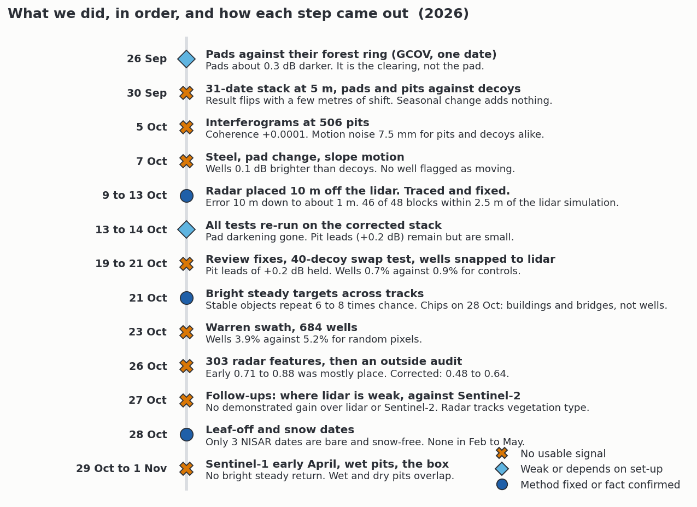

## 10. What this means and what is left

**Decision.** For this tile, rely on lidar for pads, pits and the box. More radar work is not worth the time unless one of the open items below changes.

**Open items.**
- The February to May NISAR scenes are not released yet. Validated reprocessing is planned for the fourth quarter of 2026. Re-count the catalog monthly.
- The raw files for that gap returned 403. A browser check might show whether the block is permanent.
- Scoring the three clean leaf-off dates against recorded pits and random spots has not been done. We expect little.
- A 1.5 m box needs a sensor with about 1 m resolution or better. X-band archives (Capella, ICEYE, Umbra open data, TerraSAR-X) were not queried.
- Sentinel-1 track 4 returned no data for a reason we did not find.

**Limits that apply to everything above.**
- Beta and provisional products are not validated.
- The lidar is from 2019 and the radar from 2025 and 2026. A feature may have changed in between.
- DEP well coordinates are often wrong, so well tests are blunt.
- Our annotations may miss some pits and pads. Missed ones count as negatives.
- A 5 m pixel is not five metres of independent resolving power.

## 11. Glossary

| Term | Meaning |
|---|---|
| L-band | Radar with a wavelength of about 24 cm. NISAR uses it. |
| C-band | Radar with a wavelength of about 5.6 cm. Sentinel-1 uses it. |
| Backscatter | The strength of the echo returned to the satellite, in dB. |
| dB | Decibel. A 3 dB step doubles the power. |
| HH, HV | Horizontal send and horizontal receive, and horizontal send and vertical receive. |
| Track | A fixed path over the ground that the satellite repeats every 12 days. |
| Ascending, descending | Flying north or south. |
| GSLC | NISAR product on a map grid with amplitude and phase. |
| RSLC | The same data before it is placed on a map grid. |
| Beta, provisional | Early NISAR releases. Beta is not fully calibrated. Provisional is fully calibrated and partly validated (ASF). Validated products started 2026-11-06 for new acquisitions; reprocessing of older dates is scheduled for 2027. |
| Speckle | Random grain in radar images from many small scatterers. |
| Coherence | How stable the echo stays between two dates. 1 is perfect. |
| Interferogram | The phase difference between two dates. It senses small motion. |
| Registration | How well an image is placed on the true ground. |
| AUC | Chance that a real target scores higher than a decoy. 0.5 is chance. |
| Decoy | A look-alike spot with no target, used for comparison. |
| Placebo | A test with fake targets. It should score at chance. |
| Block cross-validation | Training on some map blocks and testing on others, with a buffer between them. |
| Gate | A pass mark set in advance. Ours was +0.05 AUC over lidar. |
| pit_full, pit_inside | Our outlines for a whole pit and its interior. |

## 12. Where everything lives

Paths are relative to the repository root `C:\Users\colto\Documents\GitHub\lidar_project\`.

**This folder.**
- `nisar/writeup/README.md` is this document.
- `nisar/writeup/figures/` holds the twelve figures.
- `nisar/writeup/_make_figures.py` redraws every figure.

**Project record.**
- `nisar/docs/NISAR_FINDINGS.md` and `nisar/docs/NISAR_METHODS.md` are the outside-reader summaries.
- `docs/analysis_log.md` is the dated log, newest first.
- `nisar/docs/iterations/nisar_*.md` has one write-up per experiment. The audit is `nisar/docs/iterations/nisar_methodology_audit_20261026.md`.
- `nisar/docs/iterations/nisar_regeocode_plan_9t.md` covers the placement fix.

**Data and results.**
- `nisar/derived/9t/nisar_gslc_5m/` holds the windows as delivered.
- `nisar/derived/9t/nisar_slc_lidar_5m/` holds the lidar-placed stack.
- `nisar/results/9t/` holds the test tables, logs and chips.
- `nisar/results/9t/nisar_pit_wet_dry_db_9t.csv` is the wet and dry test.
- `data/9t/results/pit/pit_inside_wet_intensity_9t.csv` is the lidar ratio for every pit interior.
- `data/_results/pit_inside_wet_tiers_gearth.kml` is the Google Earth file for the wet check.
- `data/9t/results/pit/photo/` holds the leaf-off aerial photo windows.

**Sources for the numbers.** The figures use values from `nisar/docs/NISAR_FINDINGS.md`, `docs/analysis_log.md` and the CSV files above. Each value in `_make_figures.py` has a comment that names its source.
