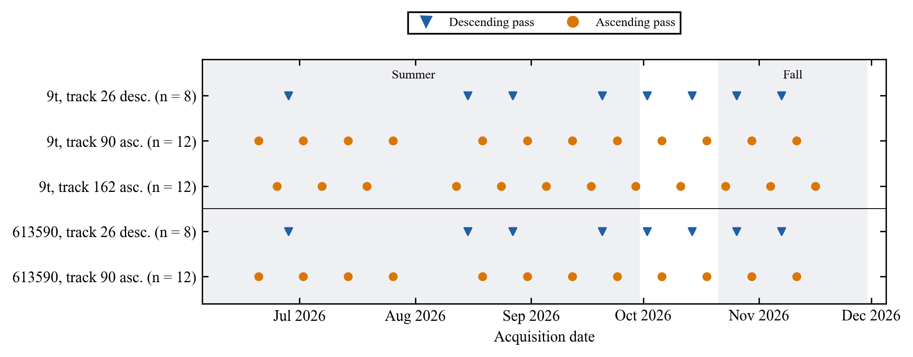
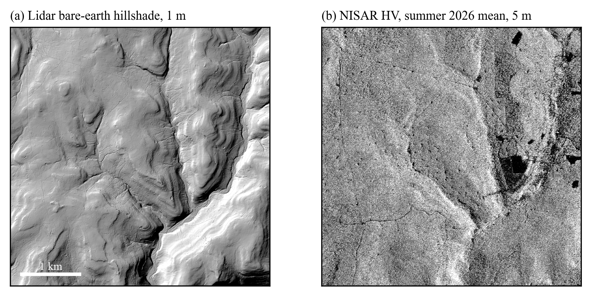

# Persistent scatterers at oil and gas wells, NISAR L-band, tile 9t, western Pennsylvania

CIVE 6359 capstone design write-up. Colton Goodrich. Draft of 2026-11-23.

## 1. Question and site

Question. On tile 9t, which pixels does NISAR L-band radar show as persistent scatterers, and do they sit at oil and gas wells more often than at nearby ground with no well?

Site. Tile 9t is a 4.5 km square in Venango County, Pennsylvania, near 41.50° N, 79.54° W. It is forested Appalachian Plateau ground with 150 years of oil drilling. Pennsylvania DEP lists 1,068 wells in the tile: 617 active, 271 plugged, 174 abandoned or orphaned, and 10 permitted but never drilled. Lidar mapping gives 650 well pads and 506 pits.

What a persistent scatterer is. A persistent scatterer is a pixel whose echo stays strong and nearly unchanged over many dates. Hard objects such as steel and buildings do this. Forest does not, because leaves and branches move between passes.

Expected signal. A well with steel above ground, such as a casing, pumpjack or tank, should give a pixel that is at least 6.5 to 7.2 dB brighter than the ground within 250 m and whose amplitude varies over dates by less than a quarter of its mean (section 3 gives the source of each number). By chance alone, a pixel passes both rules at most about 0.13% of the time. Five pixels lie within the 6 m hit radius of a well, so a well with no steel is hit by chance on one track at most about 0.65% of the time, and on any of the three tracks at most about 1.9%. With 617 active wells and five control spots each, a well hit rate about 1.7 percentage points above the control-spot rate can be detected. That uses 2.8 standard errors, the usual value for 80% power at a 5% two-sided test.

Why a radar can see it. Steel is a strong, stable reflector at radar wavelengths. A vertical casing on flat ground forms a corner with the ground that returns energy toward the satellite. Lidar maps pads and pits but cannot see a casing under canopy and is flown once.

## 2. Data

Mission and band. NISAR, L-band, 24 cm wavelength. The wells sit under deciduous canopy. A 24 cm wave passes through leaves better than C-band (5.5 cm) or X-band (3 cm), so canopy flickers less in its echo and a steel target stands out more.

Product. Level 2 geocoded single-look complex images (GSLC), HH and HV, 5 m grid, and Level 1 single-look complex images in radar geometry (RSLC). The persistent-scatterer screen uses HH, because HH favours ground and hard structures while HV favours canopy volume. The RSLC is needed to place each image on the lidar ground (section 3).

Amplitude and phase. Amplitude is the strength of the echo. Brightness is its square, echo power, in decibels. Phase is where in its cycle the wave returns. Persistent scatterers are pixels whose phase stays stable, but phase stability can only be measured after a long stack is co-registered and unwrapped. Ferretti, Prati and Rocca [4] showed that for strong targets the spread of amplitude over dates tracks the spread of phase. So the screen uses amplitude: it needs no unwrapping and works with the 8 to 12 dates per track available here. Reading motion from the phase of the selected pixels is a later step that needs about 20 or more dates per track.

Geometry at 9t.

| Track | Pass | Looks toward | Incidence angle | Dates |
|---|---|---|---|---|
| 26 | Descending | East | 41° | 8 |
| 90 | Ascending | West | 39° | 12 |
| 162 | Ascending | West | 47° | 12 |

These are all the NISAR tracks over 9t. Ascending and descending passes see each object from opposite sides. A casing shadowed by a slope on one pass can show on the other, and a target seen on two tracks is unlikely to be noise. Each track has its own geometry and calibration, so the screen runs per track and the tracks are compared only at the end.

Dates. 2026-06-20 to 2026-11-16, 12-day revisit, 32 acquisitions. Dates before 2026-06-01 are excluded. The October 2025 to January 2026 images were beta processing with different calibration, and mixing two calibrations would inflate the amplitude spread of every pixel. June 1 is the boundary between the two processing levels. Two dates on track 26 are dropped: 2026-07-22 has no valid pixels, and 2026-09-08 matches no other date of its track at any shift. A window is used when at least half its pixels are valid (first pass), so that each date covers most of the tile.

Figure 1. Dates used per track on tile 9t. Triangles are the descending track, circles the ascending tracks.

Sources. NASA ASF DAAC through ASF Vertex, collections NISAR_L2_GSLC_PROVISIONAL_V1, NISAR_L2_GSLC_V1, NISAR_L1_RSLC_PROVISIONAL_V1 and NISAR_L1_RSLC_V1 [1]. Each date is read as a window over 9t by HTTPS range requests, so a 22.6 GB file need not be downloaded whole. Checked against USGS 3DEP lidar PA_WesternPA_2019_D20 [2] and Pennsylvania DEP well locations and status [3].

## 3. Processing steps

| Step | Tool | Key choice |
|---|---|---|
| 1. Fetch windows over 9t | NASA CMR search, h5py, fsspec | Search every NISAR collection, because new dates moved to a new collection name on 2026-10-23 |
| 2. Place each image on the lidar ground | Own geocoder in Python, from RSLC | Echo height at the lidar ground plus 10% of canopy height |
| 3. Check placement | Lidar-simulated brightness, cross-correlated in 48 blocks | A block passes within 2.5 m |
| 4. Amplitude statistics per track | numpy | Mean HH power and amplitude dispersion over all post-June dates |
| 5. Select persistent-scatterer candidates | numpy, scipy | Dispersion under 0.25 and brightness at least 3 robust SD above the 250 m median |
| 6. Score wells and control spots | geopandas, scipy | Hit if a candidate lies within 6 m. Five control spots per well, 150 to 600 m away, same canopy cover |
| 7. Compare groups | scipy | Fisher's exact test of hit rates, wells against control spots, by DEP status and by number of tracks |

Placement. NASA's GSLC places pixels with an elevation model that sits partway up the canopy in forest. Against the lidar this put features 8 to 12 m off on all three tracks, always away from the satellite, and more so under taller canopy, which is what a too-high elevation model produces. Our geocoder places each image on lidar heights instead. To know the result is on the lidar ground, the lidar is used to simulate radar brightness from slope facing the satellite, and the simulation is cross-correlated with each image in 48 blocks. After placement 47 of 48 blocks agree within 2.5 m, and the median block offset is 1.0 to 1.4 m per track. This check is not independent, because the same simulation fixed each track's offset. Section 4 gives the independent checks.

Reasons for each value. Values marked first pass were set when the code was first written without a recorded reason. Their reason below was worked out afterward.

- 10% of canopy height. Of the echo heights tested, 0, 10, 25 and 50% of canopy height, 10% matched the lidar simulation best.
- 2.5 m gate (first pass). Half a 5 m pixel.
- Dispersion under 0.25. The standard cutoff of Ferretti, Prati and Rocca [4]. Pure speckle sits near 0.52, so 0.25 asks for half the variability of natural ground.
- 3 robust SD. Brightness above the 250 m median is centred on 0 dB. Its robust standard deviation, 1.4826 times the median absolute deviation, ignores a few bright targets and is 2.2 to 2.4 dB per track. Three standard deviations is the usual outlier rule and leaves about 0.13% of pixels by chance under a normal tail. On 9t this is 6.5 to 7.2 dB. It replaced a fixed 6 dB that had no recorded reason.
- 250 m background (first pass). Fifty pixels, more than twice the largest pad, so a pad or tank battery cannot set its own background, and smaller than the valley sides that change brightness across the tile.
- 6 m hit radius. A target anywhere in a 5 m pixel is at most 3.5 m from the pixel centre, and placement adds up to 2.5 m. It replaced 15 m, which dated from before lidar placement. Error in DEP well coordinates cannot be measured here and is not included.
- Control spots. Same canopy cover as the well within 0.15, because open ground and forest give different brightness. At least 60 m from every well and pad (first pass), so a control spot does not sit on another site. 150 to 600 m away (first pass): 150 m keeps clear of the well's own pad, 600 m keeps the same terrain. Five per well (first pass) keeps the run short and gives about 3,000 control spots for 617 active wells.
- Never-drilled permits. A negative control. They should be hit at the control-spot rate.

Supporting context. Pit and pad brightness against a surrounding ring and control spots tests whether the ground surface at sites differs at all, which affects the background a well target is judged against.

## 4. How I would check the result

Independent evidence. A known building at 41.502787, -79.519712 is a positive control and should pass the screen. Never-drilled permits are a negative control and should be hit only at the chance rate. A real target should pass on more than one track. Surveyed points or corner reflectors would test placement without the lidar simulation.

Results that would show something went wrong. The building fails the screen. Never-drilled permits are hit as often as active wells. The fraction of pixels that pass is well above the 0.13% expected by chance, which would mean speckle is passing. Candidates follow slopes that face one track and vanish on the others, which would mean terrain, not objects. The well hit rate peaks when the images are shifted away from zero, which would mean placement is off.

## 5. What could go wrong

| Risk at 9t | How I would notice | What I would do instead |
|---|---|---|
| Images not on the lidar ground. A leftover offset of a few metres moves the target outside the 6 m radius | Blocks fail the 2.5 m gate, the building sits off its spot, or the well hit rate peaks at a shifted position | Re-solve offsets per track, set corner reflectors, widen the radius by the measured offset |
| Too few dates. The dispersion rule was designed for about 30 dates and 9t has 8 to 12 per track, so speckle passes more often | Pass fraction above 0.13%, or candidates spread across open fields | Require a candidate on two tracks, raise the cutoff, add dates as NASA releases them |
| No steel left to see. Plugged and orphaned wells often have the casing cut or buried, and a casing is far smaller than a pixel | The building passes but wells match the control-spot rate | Compare by DEP status, since active wells keep pumpjacks and tanks. Report the limit of what a 5 m pixel can resolve |
| Layover and shadow on steep valley sides | Bright pixels that follow slope aspect and differ between ascending and descending tracks | Require two tracks, mask slopes in layover or shadow |

## 6. Plan

The project ran over eight weeks of the course. The steps below are what was done each week, taken from the dated analysis log.

| Week of | Step |
|---|---|
| 5 October 2026 | Fetch NISAR windows over 9t. First steady-target screen. Find the 8 to 12 m placement offset |
| 12 October | Write the geocoder, place images on lidar heights, rerun the screen |
| 19 October | Fix defects found by an outside review. Screen with wells snapped to lidar features |
| 26 October | Corrected scoring after a second review. Steady targets checked on hillshade and optical images |
| 2 November | Two reviews of the decisions. Checkpoint deck |
| 9 November | Checkpoint talk on 10 November. Sentinel-1 steady-target cross-check |
| 16 November | Exclude beta dates. Find the November dates in the new collection |
| 23 November | Enforce the date rule in code, set the brightness rule and hit radius from the data, rerun on 9t, write the design. Talk 1 December |

Beyond the course, the remaining steps are reading motion from the phase of the candidates once about 20 dates per track exist, and corner reflectors to test placement. Needs: about 80 MB of radar data per date, a few GB in all, one laptop, and Python with h5py, numpy, scipy, rasterio and geopandas.

## Bonus: a real product from the site

Figure 2. Tile 9t. Left, lidar bare-earth hillshade, 1 m. Right, NISAR HV mean backscatter from track 162, the eight summer dates 2026-06-25 to 2026-09-29, placed on the lidar ground and averaged in linear power. Valleys and slopes match the lidar, which shows L-band reaching the ground under canopy. Terrain lighting dominates, speckle hides anything under tens of metres, and calibration is provisional.

## 7. Changes after the oral

[To be written after December 1.]

AI disclosure. Claude (Anthropic) wrote and ran much of the processing code, produced the figures, and drafted the text of the slides and this write-up from my direction; I set the question, site, band and constraints, reviewed every step, and the design decisions are mine.

## References

1. NASA ASF DAAC. NISAR Level 1 RSLC and Level 2 GSLC products. ASF Vertex, https://search.asf.alaska.edu/
2. U.S. Geological Survey. 3DEP lidar, project PA_WesternPA_2019_D20. https://www.usgs.gov/3d-elevation-program
3. Pennsylvania Department of Environmental Protection. Oil and gas locations, April 2026 export. https://www.dep.pa.gov/DataandTools/Pages/GIS.aspx
4. Ferretti, A., Prati, C., Rocca, F. (2001). Permanent scatterers in SAR interferometry. IEEE Transactions on Geoscience and Remote Sensing 39(1), 8–20. https://doi.org/10.1109/36.898661
